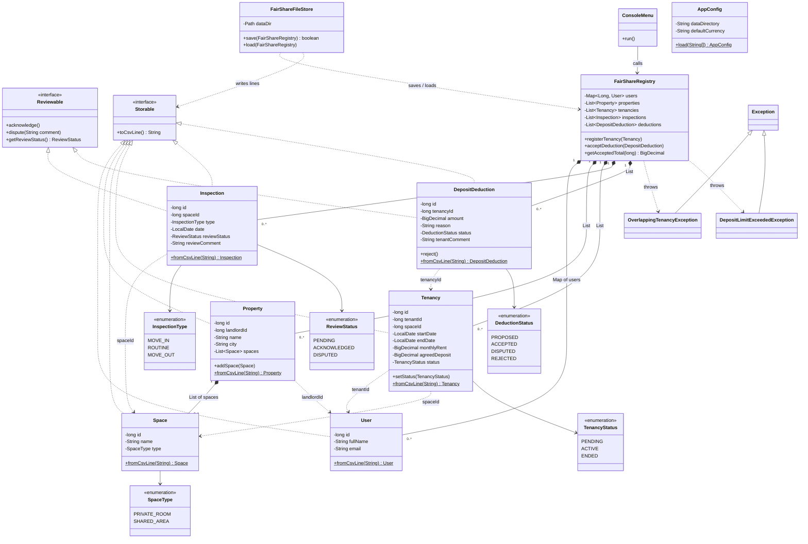

# FairShare class diagram

Mermaid source. It renders in Kiro/VS Code (Markdown preview with a Mermaid extension), on GitHub, or at https://mermaid.live (paste only the code between the fences).

Not drawn, to keep the picture readable: `Main` (starts the program and wires `AppConfig`, `FairShareFileStore`, `FairShareRegistry`, `ConsoleMenu` together).

## Audit against the course checklist

| Requirement | Result | Evidence |
|---|---|---|
| At least 4 classes of my domain | OK, 6 domain classes | User, Property, Space, Tenancy, Inspection, DepositDeduction (plus FairShareRegistry, FairShareFileStore, ConsoleMenu, AppConfig) |
| At least 2 interfaces of my domain | OK, 2 | `Reviewable` (Inspection, DepositDeduction), `Storable` (all six domain classes) |
| At least 2 collections in use | OK, 2 kinds in 6 places | `Map<Long, User>` and `List` in FairShareRegistry, `List<Space>` in Property |
| Nothing generic with no domain content | OK | The registry holds domain rules (no overlapping tenancy, deposit limit). The interfaces are `Reviewable` and `Storable`, not a generic Repository or Manager. |
| Relationships between classes shown | OK | implements, composition, id links, enum use, throws |
| Custom exceptions | OK, 2 | OverlappingTenancyException, DepositLimitExceededException |

### Honest weak spots (be ready to explain them)
- `Storable` is a technical interface (saving to files). It is real and used by every domain class and by `FairShareFileStore`, but `Reviewable` is the more domain-specific one. Present `Reviewable` first.
- There is no inheritance between domain classes. The course checklist does not require it.
- Links between objects use ids (`tenantId`, `spaceId`) and not direct references. This matches the CSV files and the database design later. Say it on purpose if asked.
